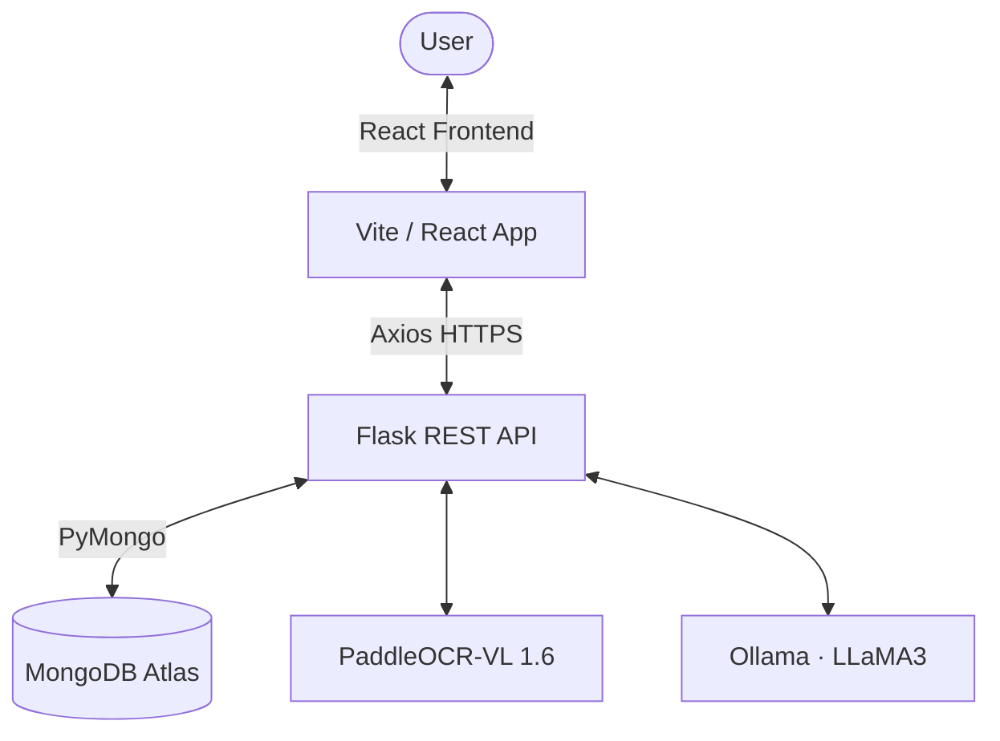
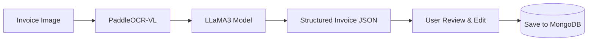
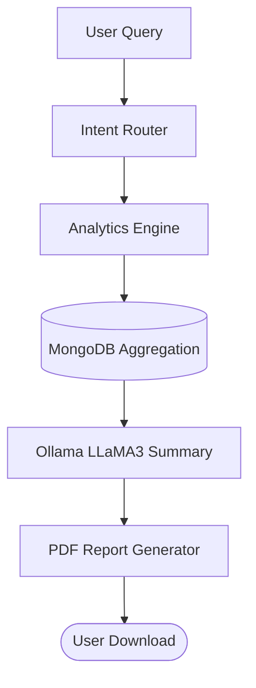

<div align="center">

# 🧾 InvoiceAI

### AI-Powered Handwritten Invoice Extraction, Business Intelligence & Reporting Platform

*Upload an invoice photo. Get structured data, analytics and PDF reports — and ask questions in plain English.*


[Overview](#-overview) •
[Features](#-key-features) •
[Architecture](#-architecture) •
[Tech Stack](#-tech-stack) •
[Getting Started](#-getting-started) •
[Docker](#-running-with-docker) •
[API](#-api-endpoints) •
[Security](#-security)

</div>

---

## 📖 Table of Contents

1. [Overview](#-overview)
2. [Why PaddleOCR-VL 1.6?](#-why-paddleocr-vl-16)
3. [Key Features](#-key-features)
4. [Architecture](#-architecture)
5. [Tech Stack](#-tech-stack)
6. [Getting Started](#-getting-started)
7. [Running with Docker](#-running-with-docker)
8. [User Roles & Permissions](#-user-roles--permissions)
9. [API Endpoints](#-api-endpoints)
10. [Database Collections](#-database-collections)
11. [Project Structure](#-project-structure)
12. [Security](#-security)
13. [Roadmap](#-roadmap)
14. [Authors](#-authors)

---

## 🎯 Overview

**InvoiceAI** is an enterprise-grade platform that automates invoice extraction, validation, analytics and reporting. It combines **OCR**, **local LLMs** and **role-based access control** to turn photos of (often handwritten) invoices into clean, reviewable, queryable data.

**Pipeline in one line:**
`Invoice image → PaddleOCR-VL → LLaMA3 cleanup → editable review form → MongoDB → analytics, chatbot and PDF reports`

---

## 🏆 Why PaddleOCR-VL 1.6?

We benchmarked several OCR models and versions on handwritten invoices. **PaddleOCR-VL 1.6**, the latest in the family, outperformed the alternatives on our use case, so it powers the extraction pipeline. A local **LLaMA3** model then post-processes the raw text into structured JSON, which fixes common handwriting errors and normalizes fields.

---

## ✨ Key Features

| Domain | Features |
| --- | --- |
| 🔐 **Authentication & Security** | Google OAuth 2.0 sign-in · JWT sessions · Role-based access (Admin / User) · Strict per-user data isolation · Full audit logging |
| 🔎 **OCR & Invoice Processing** | PaddleOCR-VL visual and text extraction · LLaMA3 post-processing · Editable review form · Review workflow (*Pending → Reviewed → Corrected*) · Automatic CGST / SGST / IGST calculation · Traceable edit history · Secure image storage |
| 📊 **Analytics & BI Dashboard** | Monthly invoice volume · Monthly revenue trend · OCR error and correction analysis · GST distribution pie chart · Top buyers · Revenue contribution by buyer (100 % stacked bar) |
| 🤖 **AI Assistant (NiBo)** | Natural-language invoice and billing queries · Revenue trend summaries · GST and tax analysis · OCR quality insights · On-the-fly business reports · PDF export via ReportLab |
| 🛠️ **Administration** | Activate / deactivate users · Real-time activity logs · System-wide volume and revenue analytics · Global invoice visibility |

---

## 🏗️ Architecture

### System data flow



### OCR processing flow



### AI assistant & reporting flow



---

## 🧰 Tech Stack

| Layer | Technologies |
| --- | --- |
| **Frontend** | React 19, Vite, Tailwind CSS, React Router, React Hook Form, Chart.js (react-chartjs-2), Axios, Lucide React, React Toastify, PapaParse |
| **Backend** | Flask, Flask-CORS, Werkzeug, PyMongo, Google Auth, PyJWT, python-dotenv |
| **AI / ML** | PaddleOCR-VL 1.6, Ollama + LLaMA3, Transformers, PyTorch |
| **Database** | MongoDB Atlas (NoSQL) |
| **Reporting** | ReportLab |
| **DevOps** | Docker, Docker Compose |

---

## 🚀 Getting Started

### Prerequisites

- Python 3.10+ and pip
- Node.js 18+ and npm
- A MongoDB instance (Atlas or local)
- [Ollama](https://ollama.com) with the `llama3` model
- A Google OAuth client ID

### 1. Clone and set up the backend

```bash
git clone https://github.com/boomiikas/Handwritten-invoice-text-extraction.git
cd Handwritten-invoice-text-extraction

python -m venv .venv
source .venv/bin/activate        # Windows: .venv\Scripts\activate

pip install -r requirements.txt
```

### 2. Configure environment variables

Create `.env` in the project root (see `.env.sample`):

```env
MONGODB_URI=mongodb+srv://<username>:<password>@cluster0.mongodb.net/
DB_NAME=invoice_db
COLLECTION_NAME=invoices
GOOGLE_CLIENT_ID=your-google-oauth-client-id
JWT_SECRET_KEY=your-secure-jwt-secret-key

# Chatbot & report settings
CHAT_CACHE_TTL_MINUTES=5
CHAT_MAX_HISTORY=50
REPORTS_DIRECTORY=reports
MAX_REPORT_RECORDS=100
OLLAMA_MODEL=llama3
REPORT_RETENTION_DAYS=30
```

Create `frontend/.env`:

```env
VITE_API_URL=http://localhost:5000
VITE_GOOGLE_CLIENT_ID=your-google-client-id.apps.googleusercontent.com
```

### 3. Start Ollama

```bash
ollama serve
ollama pull llama3
ollama list
```

### 4. Run the backend

```bash
python backend_app.py
```

### 5. Run the frontend

```bash
cd frontend
npm install
npm run dev
```

Open <http://localhost:5173>.

### 6. (Optional) Promote a user to admin

```bash
python promote_admin.py
```

---

## 🐳 Running with Docker

One command brings up the frontend, backend, MongoDB and Ollama together.

```bash
docker compose build
docker compose up -d
```

| Service | Image / runtime | URL |
| --- | --- | --- |
| `frontend` | Node 20 | <http://localhost:5173> |
| `backend` | Python 3.10-slim (Flask + OCR) | <http://localhost:5000> |
| `mongodb` | Mongo | `localhost:27017` |
| `ollama` | Ollama (LLaMA3) | <http://localhost:11434> |

**Useful commands**

```bash
docker compose up --build   # rebuild and start
docker compose ps           # check health (wait for "healthy")
docker compose down         # stop and remove containers
```

**GPU or CPU.** Compose reserves GPU resources. If an NVIDIA GPU is available (with the [NVIDIA Container Toolkit](https://docs.nvidia.com/datacenter/cloud-native/container-toolkit/latest/install-guide.html)), PyTorch uses CUDA. Otherwise it falls back to CPU automatically with no code changes.

**Persistent volumes** avoid re-downloading models after restarts:

| Volume | Stores |
| --- | --- |
| `hf_cache` | `PaddlePaddle/PaddleOCR-VL-1.6` weights |
| `ollama_data` | Ollama models (e.g. `llama3`) |
| `mongo_data` | MongoDB data |
| `uploads_data`, `reports_data`, `invoice_slices_data` | Uploaded images, reports, image slices |

> Make sure a root `.env` with `GOOGLE_CLIENT_ID` and `JWT_SECRET_KEY` exists before starting.

---

## 👥 User Roles & Permissions

| Action | Standard user | Administrator |
| --- | :---: | :---: |
| Upload invoice image | ✅ | ✅ |
| Edit / review extracted invoice | ✅ own only | ✅ all |
| View analytics dashboard | ✅ own data | ✅ all |
| Ask NiBo chatbot | ✅ own data | ✅ all systems |
| Generate and export PDF reports | ✅ | ✅ |
| Access admin dashboard and logs | ❌ | ✅ |
| Manage users (block / activate) | ❌ | ✅ |
| Global system-wide visibility | ❌ | ✅ |

---

## 🔌 API Endpoints

<details open>
<summary><b>Authentication & Invoices</b></summary>

| Method | Endpoint | Description |
| --- | --- | --- |
| POST | `/api/auth/google` | Exchange a Google OAuth credential for a JWT |
| GET | `/api/invoices` | Invoice history (scoped by role) |
| POST | `/api/invoices` | Upload an invoice image and run the OCR pipeline |
| GET | `/api/invoices/<id>` | Fetch one invoice |
| PUT | `/api/invoices/<id>` | Submit corrections |
| DELETE | `/api/invoices/<id>` | Delete an invoice |

</details>

<details open>
<summary><b>Analytics, Chat & Reports</b></summary>

| Method | Endpoint | Description |
| --- | --- | --- |
| GET | `/api/analytics` | User-scoped analytics |
| GET | `/api/admin/analytics` | Global system KPIs |
| POST | `/api/chat/query` | Ask NiBo a question |
| POST | `/api/chat/report` | Generate a PDF report from chat context |
| GET | `/api/reports` | List generated reports |
| GET | `/api/reports/download/<filename>` | Download a report |
| DELETE | `/api/reports/<id>` | Delete a report record |

</details>

<details open>
<summary><b>Admin</b></summary>

| Method | Endpoint | Description |
| --- | --- | --- |
| GET | `/api/admin/users` | List all users |
| PUT | `/api/admin/users/<id>/status` | Activate or block a user |
| GET | `/api/admin/activity` | System audit logs |

</details>

---

## 🗄️ Database Collections

<details>
<summary><b>users</b> — accounts, roles, session timestamps</summary>

`_id` · `email` (unique) · `name` · `role` (`user` \| `admin`) · `is_active` · `created_at` · `last_login`

</details>

<details>
<summary><b>invoices</b> — OCR output, edited data, correction history</summary>

`_id` · `user_id` · `file_path` · `extracted_data` (raw OCR) · `invoice_data` (active / edited) · `review_status` (`Pending Review` \| `Reviewed` \| `Corrected`) · `change_history` (timestamp, edited_by, diff) · `created_at`

`invoice_data` contains: `invoice_number`, `invoice_date`, `vendor_name`, `buyer_name`, `items[]` (description, quantity, rate, cgst_amount, sgst_amount, igst_amount, amount), `total_tax`, `total_revenue`.

</details>

<details>
<summary><b>activity_logs</b> — immutable audit trail</summary>

`_id` · `user_id` · `user_email` · `action` (e.g. `ocr_upload`, `invoice_edit`, `login`, `chatbot_query`) · `metadata` · `timestamp`

</details>

<details>
<summary><b>reports</b> — exported PDF catalog</summary>

`_id` · `user_id` · `report_type` (`monthly_report`, `quarterly_report`, `yearly_report`) · `generated_at` · `pdf_filename` · `summary` (LLM overview)

</details>

---

## 📁 Project Structure

```
Handwritten-invoice-text-extraction/
├── backend_app.py          # Flask REST API and routes
├── ocr_engine.py           # PaddleOCR-VL + LLM extraction pipeline
├── chatbot_service.py      # NiBo assistant orchestrator and cache
├── intent_router.py        # Chatbot intent classifier
├── analytics_queries.py    # MongoDB aggregation builders
├── report_generator.py     # LLM report summaries
├── pdf_generator.py        # ReportLab PDF compilation
├── promote_admin.py        # Elevate a user to admin
├── streamlitocr.py         # Streamlit OCR demo
├── Dockerfile
├── docker-compose.yml
├── requirements.txt
├── .env.sample
├── invoice_slices/         # Sliced invoice image regions
├── reports/                # Generated PDF reports
└── frontend/               # React + Vite client
    ├── package.json
    ├── vite.config.js
    ├── tailwind.config.js
    └── src/
        ├── main.jsx
        ├── App.jsx
        ├── components/     # Layout, ChatAssistant, ProtectedRoute
        ├── pages/          # Dashboard, Analytics, AdminDashboard, ...
        ├── services/       # api.js
        └── utils/          # csvExport.js
```

> Other root files (`demo.py`, `copy2.py`, `dynamic.py`, `para.py`, `end.py`, `changellm.py`, sample images and JSON) are experiments and test artifacts from OCR model comparison.

---

## 🔒 Security

- **JWT verification.** Every protected route needs a valid Bearer token, and expiry is enforced.
- **RBAC.** Admin routes are blocked for standard users at the backend.
- **Ownership validation.** Users cannot read, edit or query other users' invoices.
- **Path-traversal protection.** Report download paths are sanitized.
- **Immutable audit logs.** Logins, edits and admin actions are stored in `activity_logs`.
- **Google token integrity.** OAuth credentials are verified with Google's `id_token` endpoint.

---

## 🗺️ Roadmap

- [ ] Scheduled weekly / monthly reports delivered by email
- [ ] Send invoice copies and payment reminders from the app
- [ ] Multi-language OCR support
- [ ] Billing and tax-cycle forecasting
- [ ] Vendor risk analysis to flag price variations and duplicate invoices

---

## 👩‍💻 Authors

| Name | Links |
| --- | --- |
| **Boomika S** | [GitHub](https://github.com/boomiikas) · [LinkedIn](https://www.linkedin.com/in/boomika-s-981b55311/) |
| **Nithya Shri S K** | [GitHub](https://github.com/NithyaShriSK) · [LinkedIn](https://www.linkedin.com/in/nithya-shri-s-k-670531353/) |

Forked from [NithyaShriSK/Handwritten-invoice-extarction-using-PaddleocrVL1.6](https://github.com/NithyaShriSK/Handwritten-invoice-extarction-using-PaddleocrVL1.6).

---

<div align="center">

⭐ If you find this useful, consider starring the repo!

</div>
